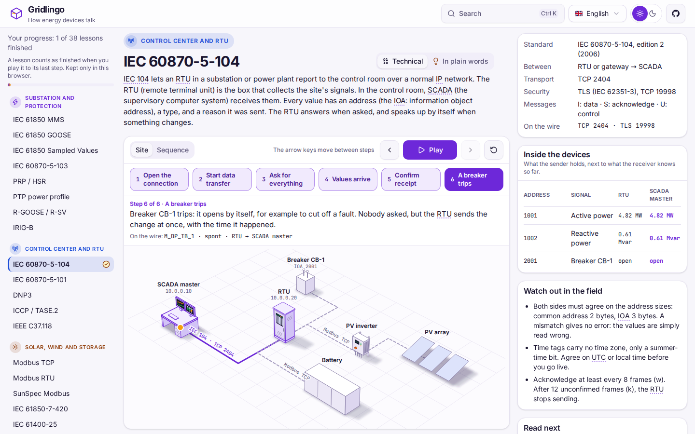
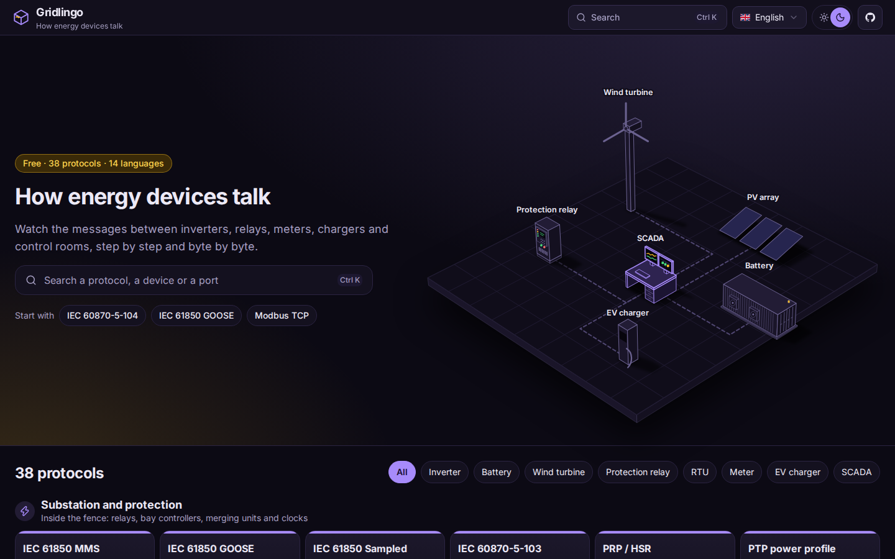
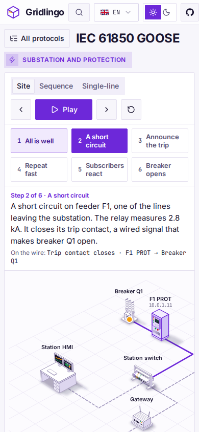
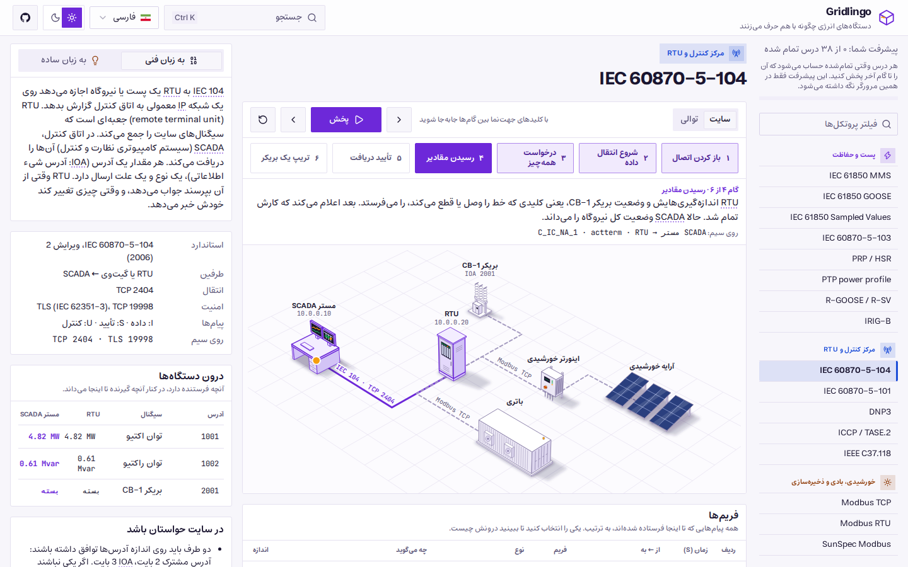

<h1>
  <picture>
    <source media="(prefers-color-scheme: dark)" srcset="docs/images/logo-dark.svg">
    
  </picture>
</h1>

> **How energy devices talk. A visual guide to the protocols of power plants, substations, meters and chargers: step by step and byte by byte, in your browser.**

[](https://github.com/araminix/gridlingo/actions/workflows/ci.yml)
[](LICENSE)
[](https://araminix.github.io/gridlingo/)

Gridlingo shows what really happens between an RTU and the control room, between two protection relays, between a
charger and its back end. Each lesson plays one real job, step by step: the devices on an isometric site, the
messages between them, every byte of each frame and what it means, and what each device knows afterwards.

**[Open it](https://araminix.github.io/gridlingo/)**: no account, no server, nothing to install.



## What a lesson shows

- **In plain words**: what the protocol is for, with an everyday comparison and no jargon, before anything else.
- **The site**: the devices drawn in place (SCADA, RTUs, relays, inverters, batteries, turbines, meters, chargers),
  the cables between them, and each frame travelling on its way.
- **The sequence**: who sends what to whom, in order.
- **The single-line diagram**, for substation protocols: breakers opening, faults, messages on the station and
  process bus.
- **The bytes** of each frame, coloured by what they carry, each run explained in plain words.
- **Inside the devices**: what the sender holds and what the receiver knows, step by step.
- **Timing**, when time is the point: GOOSE repeats, sample streams, time codes, the charging pilot signal.
- **Names taken apart**: IEC 61850 object references, OBIS codes, MQTT topics.
- **A playground**: turn a number into bytes in each byte order (and see what a wrong order makes of it), walk an
  IEC 61850 SCL file as a tree (the sample or your own, read in your browser), read sample files line by line, turn
  a charger's current into its pilot duty cycle and back, write a time as an IRIG-B frame.
- **Watch out in the field**: the mistakes people really make.
- **A glossary on every term**: abbreviations such as ACK, RTU or CRC are underlined; a tap shows the full name and
  one plain sentence, in your language.

## One event, several protocols

A fault on a feeder, a relay trips, a breaker opens: the comparison page (`/compare`) tells that one event in up to
four protocols side by side (IEC 61850 GOOSE, IEC 60870-5-104, -101 and -103, DNP3, Modbus TCP). It shows when each
receiver learns of it, the bytes of each frame with one meaning lit up across all of them, and what each frame can say
about the time, the quality and the reason. The choice stays in the address, so it can be shared.

## 41 protocols

| Where you meet them | Protocols |
| --- | --- |
| Substation and protection | IEC 61850 MMS, GOOSE and Sampled Values, IEC 60870-5-103, PRP / HSR, PTP power profile, R-GOOSE / R-SV, IRIG-B, NTP / SNTP |
| Control center and RTU | IEC 60870-5-104, IEC 60870-5-101, DNP3, ICCP / TASE.2, IEEE C37.118 |
| Solar, wind and storage | Modbus TCP, Modbus RTU, SunSpec Modbus, IEC 61850-7-420, IEC 61400-25, CAN / CANopen |
| EV charging and DER | OCPP, ISO 15118, IEC 61851, OCPI, IEEE 2030.5, OpenADR |
| Metering | DLMS/COSEM, IEC 62056-21, M-Bus / wM-Bus, ANSI C12.18 / 19 / 22, G3-PLC / PRIME |
| IoT and cloud | MQTT, Sparkplug B, OPC UA, LoRaWAN, BACnet/IP |
| Security | IEC 62351, DNP3 Secure Authentication, Modbus/TCP Security, IEC 62443, SNMP |

## For everyone

- **Three kinds of readers**: professionals get the exact bytes, students get every term explained where it first
  appears, and someone with no background can read the plain-words box and follow the pictures.
- **14 languages:** English, 中文, हिन्दी, Español, Français, العربية, فارسی, Português, Русский, 日本語, Deutsch, 한국어,
  Türkçe and Italiano, with Arabic and Persian right to left.
- **Light and dark themes**: it opens light, and keeps the one you choose.
- **Phones and tablets**: every view fits a small screen.
- **Your progress** is kept in your browser; nothing is sent anywhere.

| The library, dark | On a phone | Persian, right to left |
| --- | --- | --- |
|  |  |  |

## Exact, and in plain words

Every byte in a lesson is one a real device would accept: the tests check lengths, CRCs and checksums, BER
encoding, sequence numbers and that values decode to what the text says. The words are our own, short and plain;
nothing is copied from a standard, and the standards themselves have the final say. Sample files are made up.

## Run it yourself

You need Node.js 22 or later and pnpm 11.

```bash
git clone https://github.com/araminix/gridlingo.git
cd gridlingo
pnpm install
pnpm dev      # http://localhost:5173
```

`pnpm build` writes a static site to `dist` that any web server can host; set `BASE_PATH` when it is served from a
sub-path (`BASE_PATH=/gridlingo/ pnpm build`) and `SITE_URL` to its full address for link previews and the sitemap.
Pushes to `main` publish it on GitHub Pages ([CI](.github/workflows/ci.yml)).

## How it is built

```
src/
  lessons/        one folder per protocol: lesson.ts (data and bytes), <lang>.json (texts), lesson.test.ts (byte checks)
  glossary/       the terms explained on a tap, one file per language
  viz/            the site, the sequence, the single-line diagram, the byte inspector, timing, the step player
  playground/     the number encoder, the SCL explorer, sample files, the pilot signal and IRIG-B tools
  pages/          the library, the lesson workspace and the comparison page
  components/ui/  shadcn/ui components
  i18n/           the 14 interface languages
e2e/              end-to-end and visual tests (Playwright), on a desktop and a phone
scripts/          screenshots.mjs retakes the README pictures and the link-preview banner after a visual change
```

React 19, TypeScript, Tailwind CSS and [shadcn/ui](https://ui.shadcn.com), built with Vite. A lesson is data:
adding a protocol is adding a folder ([docs/lessons.md](docs/lessons.md)).

## Contributing

Corrections, lessons and translations are welcome: see [CONTRIBUTING.md](CONTRIBUTING.md). Found a security problem?
See [SECURITY.md](SECURITY.md).

## License

[MIT](LICENSE). The names of the standards belong to their owners (IEC, IEEE, the DNP Users Group, the Modbus
Organization, the Open Charge Alliance, the OPC Foundation, the LoRa Alliance and others); Gridlingo is not affiliated
with them.
